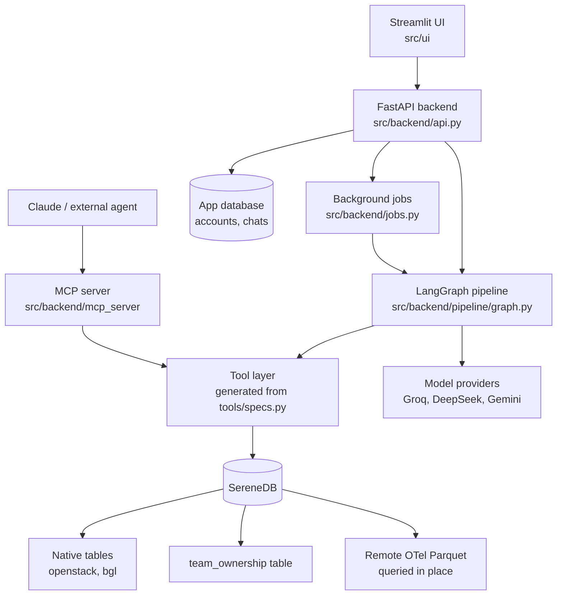
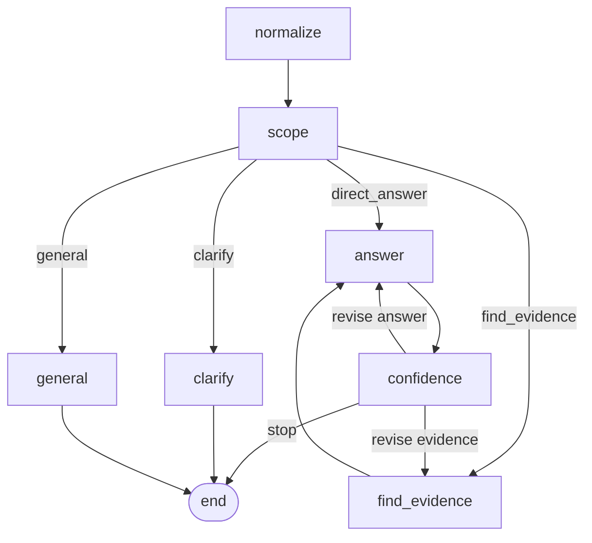

# Architecture

## The system

The Streamlit UI is a thin client: it holds a bearer token and talks to the FastAPI backend over HTTP. The backend owns accounts and chat history in an app database, starts background investigations through `backend/jobs.py`, and runs the LangGraph pipeline. The pipeline's evidence stage calls a tool layer, and every tool is generated from a single spec table (`src/backend/pipeline/tools/specs.py`). The tool layer queries SereneDB: two native tables (`openstack`, `bgl`), the `team_ownership` table, and the remote OTel Parquet corpus, queried in place. The same tool layer is exposed by an optional MCP server so Claude can use the same tools; the pipeline's own model calls go to the configured providers (Groq, DeepSeek, Gemini).

## The investigation graph

- **normalize** structures the raw conversation into a usable question.
- **scope** is a code-owned routing decision over independent classifier judgments: non-log requests go to a general reply, vague log requests are clarified unless the user authorized proceeding or the budget is spent, and otherwise the pipeline either answers directly or investigates.
- **find_evidence** is a single deep agent that plans the investigation and calls the database tools itself. The evidence report is assembled off-agent: code builds one item per tool call (name, arguments, success or failure, linked results), and the model writes only the summary and at most three hypotheses citing those items.
- **answer** explains the evidence; the labelled findings ledger and the "Data scope and queries" appendix are rendered in code, not by the model (see [grounding.md](grounding.md)).
- **confidence** can send the evidence or the answer back for revision under the per-effort loop budget, and otherwise ends the turn.

## Components

- **UI** (`src/ui`) — Streamlit pages: sign-in, chat list, the chat box with type-ahead, the live progress panel, and the per-answer role buttons.
- **API** (`src/backend/api.py`) — FastAPI endpoints for auth, chats, streaming, background investigations, the role switch, auto-complete and operations.
- **Jobs** (`src/backend/jobs.py`) — an in-process registry that runs an investigation on a worker thread, buffers its events for re-attachment, and persists the result.
- **Pipeline** (`src/backend/pipeline/graph.py`) — the LangGraph nodes and wiring, with a durable checkpointer.
- **Evidence agent and playbooks** — the `find_evidence` deep agent plus the role playbooks in `skills/`, injected into its prompt.
- **Tool layer and result envelope** (`src/backend/pipeline/tools/`) — every tool declared once in `specs.py`; every result is the shared envelope from `envelope.py`.
- **Database layer and corpora** (`src/backend/db/`) — the dataset registry, pooled connections, and the query builders.
- **App data store** (`src/backend/appdb/`) — users, sessions, chats and messages.
- **MCP service** (`src/backend/mcp_server/`) — the standalone server assembled from the same sources.
- **Models** (`src/backend/pipeline/models.py`) — the chat model instances and the atomic classifiers.

## Where things live

The full file map is in the README's [Project layout](../README.md#project-layout) section.
