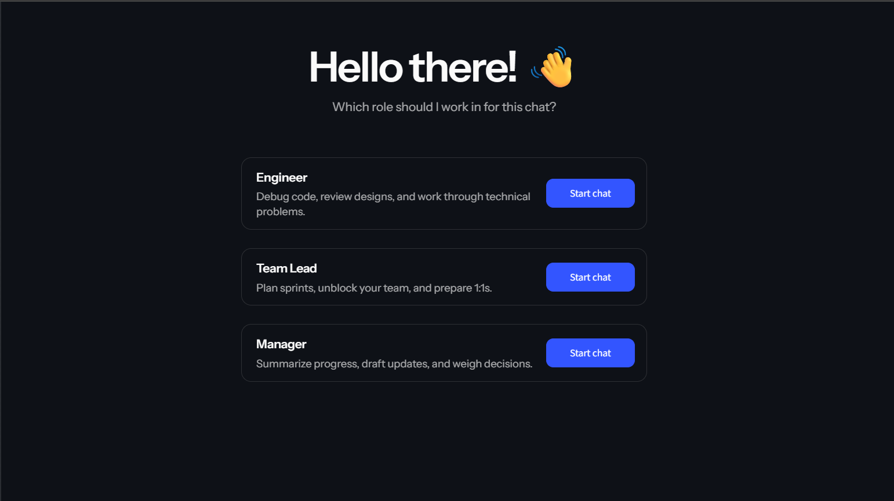
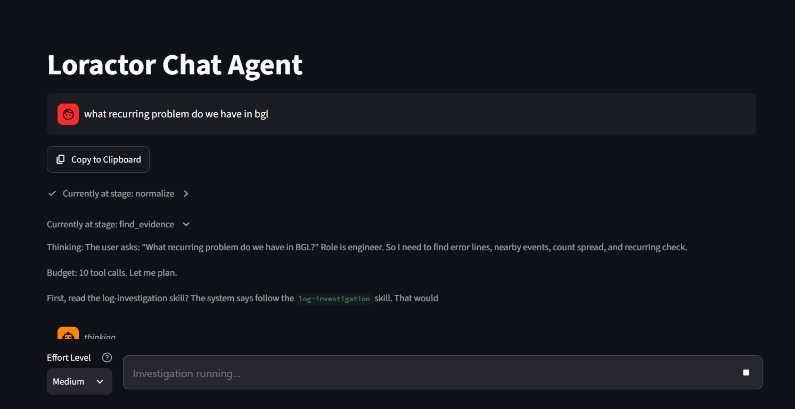
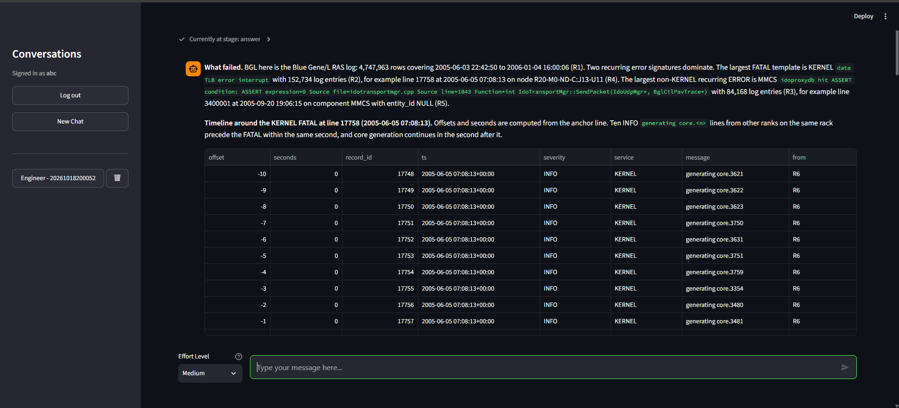

# loractor

Log investigation for engineers, team leads, and managers — one workflow from question to evidence to recommendation.

## Why we built it

An AI agent can help explain a failure, but millions of log lines will not fit into one prompt. The database searches and calculates; the agent explains what happened using the evidence that comes back. Three people ask about the same logs but need different evidence and different decisions, so the role changes which questions are asked, which evidence is selected and which actions are recommended — not just the length of the answer. The loractor project was built for the "Making Sense of Logs: The Right Insights for the Right People" challenge of the National AI Hackathon 2026 by SchubKI.

## What it is

At its core, loractor is a role-aware log-investigation assistant. A Streamlit UI talks to a FastAPI backend, which runs a LangGraph pipeline that queries a SereneDB log database. The pipeline searches and aggregates in the database, then explains the returned evidence for the chosen role.

- **A complete flow** from the UI (`src/ui`) to the API (`src/backend/api.py`) to the pipeline (`src/backend/pipeline/graph.py`) to SereneDB.
- **Role-aware answers** for the engineer, the team lead and the manager — each gets different evidence and next steps (see [roles.md](roles.md)).
- **Answers grounded in executed queries**: every measured statement is traceable to the result it cites, and every answer ends with a labelled findings ledger and a query appendix (see [grounding.md](grounding.md)).
- **Background investigations** that keep running after the browser tab closes, with a live progress panel.
- **An MCP server** so Claude can use the same search and summary tools (see [mcp-server.md](mcp-server.md)).
- **A worked-investigation document** that records one real topic answered as all three roles (see below).

## Screenshot








## The docs

| Page | What it covers |
| --- | --- |
| [roles.md](roles.md) | One workflow, three roles: the question, evidence and next steps per role. |
| [architecture.md](architecture.md) | The system and the per-turn investigation graph, with diagrams. |
| [grounding.md](grounding.md) | How answers stay grounded: the findings ledger, result kinds, the checks. |
| [mcp-server.md](mcp-server.md) | The MCP server: tools, skills, prompts, resources, how to run it. |
| [quick-start.md](quick-start.md) | The short path from a clean checkout to a first answer. |
| [TOOLS.md](../TOOLS.md) | The full tool catalogue: every tool, its arguments and its result contract. |
| [limitations.md](limitations.md) | What the current build does not do, grouped by cause. |
| [data-sources.md](data-sources.md) | The log corpora, their licences and the canonical schema. |
| [worked investigation](worked_investigation.md) | One real topic answered as all three roles, generated from live runs. |
| [README](../README.md) | The deep handbook: setup, configuration, corpora, testing and the full API. |
| [AGENTS.md](../AGENTS.md) | Contributor and agent guide to the codebase. |

## Worked investigation

[`docs/worked_investigation.md`](worked_investigation.md) is a real captured run of one topic — **BGL FATAL and ERROR events** — answered as the engineer, the team lead and the manager. For each role it records the question, the route, the tool calls, the executed queries, the key rows, the evidence report, the answer and the recommended action, and it ends with what the data does and does not establish.

Read it as an end-to-end example: the same agent and corpus produce three different investigations, and every number in an answer can be traced to a query in the appendix.

Regenerate it against the current code and a live database:

```bash
bash ./worked_investigation.sh --topic "<a real issue or recurring pattern>"
```

The committed capture is from **2026-10-18**, and its engineer section records that no full-text search result was captured in that run — regenerate for a fresh, complete capture. The file is generated from live runs; do not edit it by hand (see the note at the top of the document).
